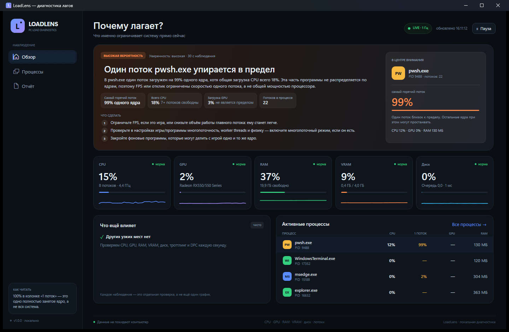
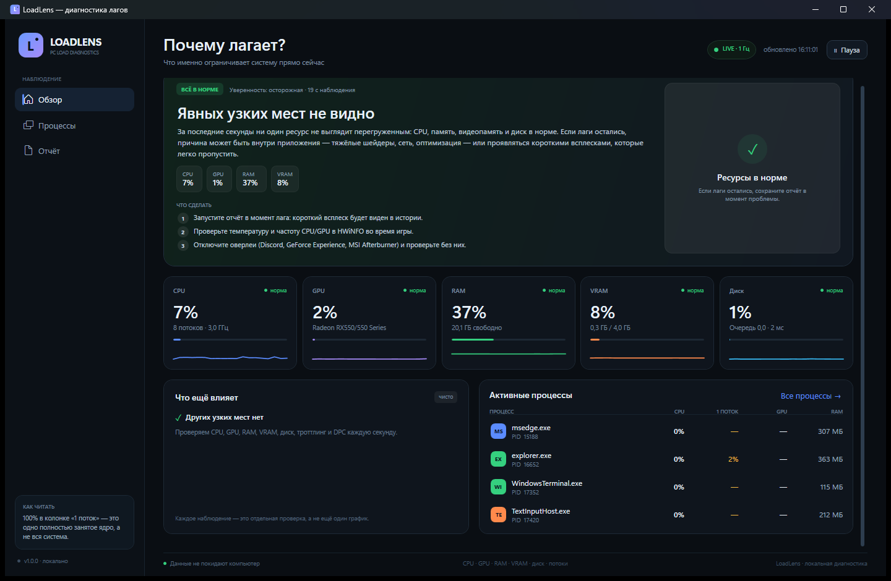
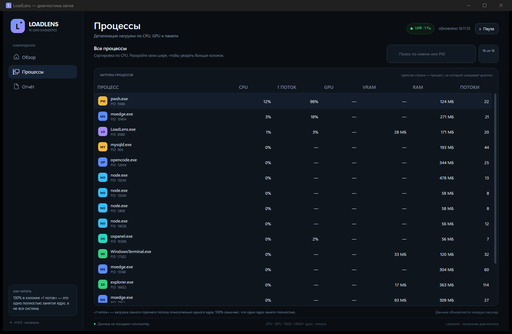
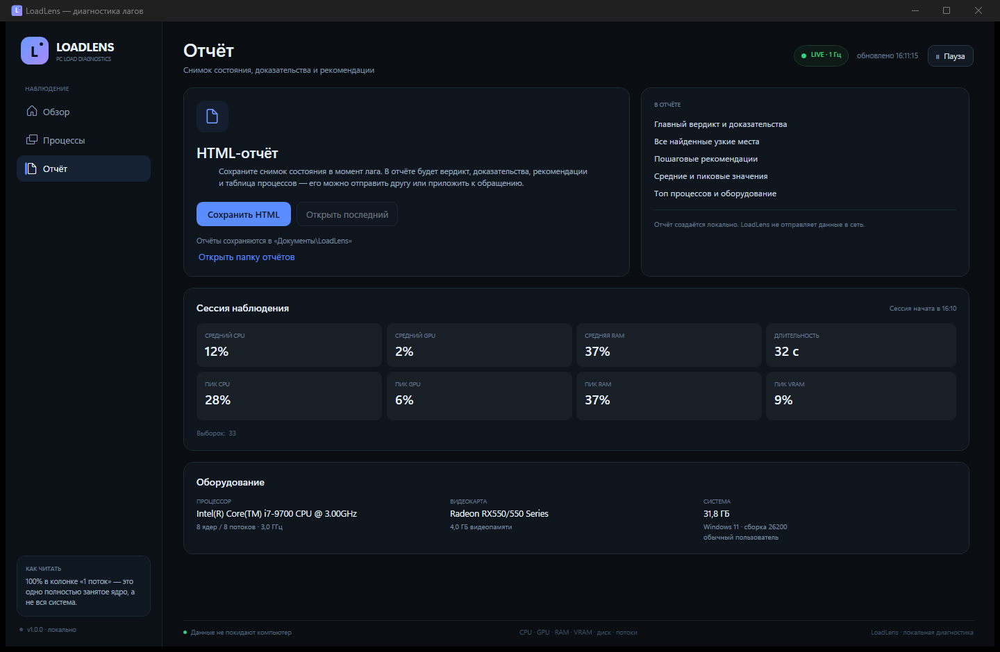
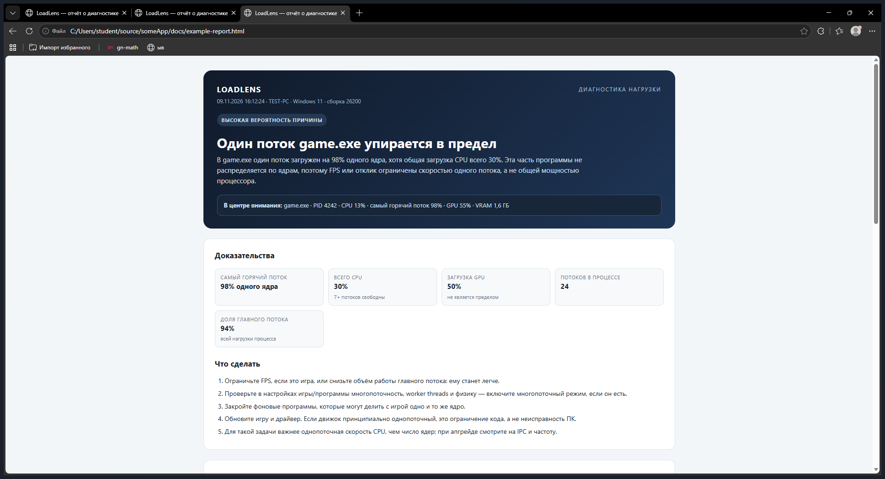

# LoadLens

**Диагностика не «что нагружено», а «почему лагает».**

Обычные мониторы показывают проценты и заставляют пользователя самого догадываться, в чём причина. LoadLens смотрит на сочетание показателей и объясняет понятным языком: игра упирается в один поток, закончилась видеопамять, система ушла в файл подкачки, диск не успевает или видеокарта работает на пределе.



> На скриншоте тестовая однопоточная нагрузка. LoadLens видит, что один поток занят на 100% одного ядра, общий CPU — 19%, GPU — 4%, и делает вывод: предел в однопоточной части программы, а не в недостатке ядер.

## Что умеет

- **Находит упор в один поток.** Читает время CPU каждого потока процесса и сравнивает его с общей загрузкой. Если один поток стабильно занимает почти целое ядро, а остальные простаивают — объясняет, что FPS/отклик ограничен скоростью этого потока.
- **Проверяет нехватку RAM по-настоящему.** Смотрит не только «занято 90%», а свободную физическую память, commit charge, файл подкачки и `Pages Input/sec` (чтение с диска). Показывает, когда Windows уже свопится, а не просто держит данные в кэше.
- **Следит за VRAM и shared-памятью.** Занятая видеопамять, её физический объём и выгрузка в общую память. При заполнении VRAM объясняет, почему текстуры начинают подгружаться через PCIe и появляются микрофризы.
- **Различает упор в GPU, CPU, диск и троттлинг.** Высокая загрузка GPU — это не «поломка», а предел видеокарты; низкая частота CPU под нагрузкой — повод проверить охлаждение.
- **Показывает виновника.** В центре внимания — процесс, который создаёт нагрузку. В таблице процессов видно CPU, самый горячий поток, GPU, VRAM, RAM и число потоков.
- **Даёт доказательства и действия.** У каждого вывода есть цифры-подтверждения и 3–5 конкретных шагов: что снизить, что закрыть, что проверить.
- **Формирует HTML-отчёт.** Снимок состояния, вердикт, доказательства, рекомендации, средние/пиковые значения и таблица процессов. Отчёт можно открыть в браузере и отправить.
- **Работает локально.** Без аккаунта, телеметрии и отправки данных в сеть. Права администратора не требуются (но часть защищённых процессов может быть недоступна для чтения потоков).

## Как это работает

LoadLens опрашивает систему раз в секунду и хранит короткую историю. Диагноз ставится не по одному скачку, а по устойчивой картине за несколько выборок.

| Что проверяется | Как измеряется | Когда появляется вывод |
|---|---|---|
| Один поток | Время CPU каждого потока через `ProcessThread.TotalProcessorTime`; доля одного логического ядра | Горячий поток ≥ 82% ядра 3 выборки подряд, общий CPU < 88%, GPU < 90%, процесс использует заметную часть ядра |
| Нехватка RAM | `GlobalMemoryStatusEx`, commit charge, `Pages Input/sec`, файл подкачки | Мало свободной физической памяти **и** высокий commit или активное чтение из подкачки |
| Нехватка VRAM | PDH `GPU Local Adapter Memory`, `GPU Adapter Memory`, `GPU Process Memory`; физический объём из DXGI | VRAM ≥ 90% несколько выборок, особенно при росте shared-памяти |
| Перегруз CPU | Суммарная загрузка всех логических ядер + очередь | Средняя загрузка ≥ 90% или ≥ 78% при очереди больше числа ядер |
| Предел GPU | PDH `GPU Engine` по 3D/compute-движкам | GPU ≥ 95%, CPU не перегружен, VRAM не переполнена |
| Диск | `% Disk Time`, очередь, `Avg. Disk sec/Transfer` | Диск ≥ 88% и очередь ≥ 2 или задержка ≥ 25 мс |
| Троттлинг | `% Processor Performance` под нагрузкой | Эффективная частота < 76% расчётной при CPU ≥ 45% (это эвристика, точные температуры нужно смотреть в HWiNFO) |
| DPC/прерывания | `% DPC Time` + `% Interrupt Time` | ≥ 8% несколько выборок — повод проверить драйверы |

### Почему не просто «CPU 30%»

Самый показательный пример: игра может показывать общий CPU 25%, но один её поток будет занимать целое ядро. Добавление ещё восьми ядер такой игре не поможет — ей нужен более быстрый один поток. LoadLens видит это по потокам, а не по среднему проценту.

Похожая логика с памятью: «RAM занята на 90%» само по себе не проблема, если это кэш. Проблема начинается, когда свободной памяти мало и система вынуждена читать страницы с диска. Поэтому в диагностике участвуют `Available MBytes`, commit и `Pages Input/sec`.

## Скриншоты

### Обзор

Вердикт, доказательства, рекомендации, пять ключевых датчиков и активные процессы на одном экране.



### Процессы

Сортировка по CPU, подсветка процесса из диагноза, колонка «1 поток» и загрузка GPU/VRAM по каждому процессу.



### Отчёт

HTML-отчёт сохраняется в `Документы\LoadLens` и открывается в браузере.





## Требования

- Windows 10 1809+ или Windows 11, **x64**.
- [.NET 9 Desktop Runtime](https://dotnet.microsoft.com/download/dotnet/9.0) для запуска готовой сборки.
- Для сборки — .NET 9 SDK.
- Желательно наличие драйвера GPU с поддержкой счётчиков WDDM (`GPU Engine`, `GPU Adapter Memory`). На виртуальных машинах и в некоторых удалённых сессиях GPU-метрики могут быть недоступны — остальная диагностика продолжит работать.

## Запуск

Из исходников:

```powershell
dotnet run --project src/LoadLens.App/LoadLens.App.csproj -c Release
```

Или:

```powershell
.\run.ps1
```

После сборки:

```powershell
dotnet build LoadLens.sln -c Release
.\src\LoadLens.App\bin\Release\net9.0-windows\LoadLens.exe
```

Перед пересборкой закройте запущенный LoadLens: Windows блокирует файлы в `bin`.

## Как пользоваться

1. Запустите LoadLens **до** проблемной игры/программы.
2. Запустите игру и поиграйте 10–20 секунд в проблемном месте.
3. Вернитесь на вкладку «Обзор»: через 5 секунд после запуска появится вердикт.
4. Если лаги короткие и не попадают в момент просмотра — нажмите «Сохранить HTML» сразу после лага: в отчёте останутся история и пиковые значения.
5. Начните с первого пункта в «Что сделать». Вторичные причины перечислены в блоке «Что ещё влияет».

### Что означают колонки

- **CPU** — доля от всей системы (как в диспетчере задач).
- **1 поток** — загрузка самого горячего потока относительно **одного** логического ядра. `100%` = одно ядро занято полностью.
- **GPU** — суммарная загрузка 3D/compute-движков выбранного адаптера.
- **VRAM** — видеопамять, занятая процессом.
- **RAM** — рабочий набор процесса.

## Сборка и публикация

```powershell
# обычная сборка
dotnet build LoadLens.sln -c Release

# переносимый вариант (нужен .NET 9 Desktop Runtime на целевой машине)
.\publish.ps1

# self-contained: .NET не нужен на целевой машине, размер больше
.\publish.ps1 -SelfContained
```

Результат появится в `artifacts\LoadLens-win-x64`.

## Тесты

В репозитории есть консольный harness без внешних тестовых пакетов:

```powershell
dotnet run --project tools/LoadLens.DiagHarness/LoadLens.DiagHarness.csproj -c Release
```

Проверяются сценарии: один поток, нехватка RAM, нехватка VRAM, упор в GPU, перегруз CPU, троттлинг, здоровое состояние, калибровка и генерация HTML.

Живой прогон метрик:

```powershell
dotnet run --project tools/LoadLens.DiagHarness/LoadLens.DiagHarness.csproj -c Release -- probe 10
```

## Структура

```text
src/
  LoadLens.Core/            — метрики, PDH/DXGI/win32, правила диагностики, HTML-отчёт
  LoadLens.App/             — WPF-интерфейс (обзор, процессы, отчёт)
tools/
  LoadLens.DiagHarness/     — сценарные тесты и live-probe
docs/                       — скриншоты и инструкция по GitHub
```

Основные точки:

- `SystemSampler` — собирает один снимок системы.
- `ProcessMeter` — CPU процесса и самого горячего потока.
- `GpuMeter` — PDH-счётчики GPU + физический объём VRAM из DXGI.
- `DiagnosisEngine` — правила и объяснения.
- `HtmlReportBuilder` — автономный HTML-отчёт.
- `MainViewModel` — состояние экрана и обновление раз в секунду.

## Ограничения

- LoadLens **не измеряет frame time внутри игры**. Он объясняет ограничения по ресурсам; для точной картины кадров используйте PresentMon/CapFrameX.
- Температуры GPU/CPU не читаются напрямую: вывод о троттлинге делается по падению эффективной частоты. Для точных температур — HWiNFO.
- На интегрированной графике VRAM не диагностируется как отдельный ресурс: iGPU использует общую RAM, и за неё отвечает проверка RAM.
- Некоторые защищённые процессы не отдают время потоков. Для них колонка «1 поток» будет пустой, но общий CPU и память останутся.
- Пороговые значения — эвристики. Они подобраны так, чтобы не срабатывать на короткие всплески, но не заменяют ручную проверку в спорной ситуации.

## Приватность

Все измерения выполняются локально. LoadLens не содержит сетевого кода, не отправляет отчёты и не требует аккаунта. HTML-отчёт создаётся только по кнопке и сохраняется на диск.

## Публикация на GitHub

Локальный git-репозиторий уже инициализирован внутри папки проекта (не в домашней папке пользователя). Пошаговая инструкция — в [docs/GITHUB.md](docs/GITHUB.md).

## Лицензия

MIT. См. [LICENSE](LICENSE).
